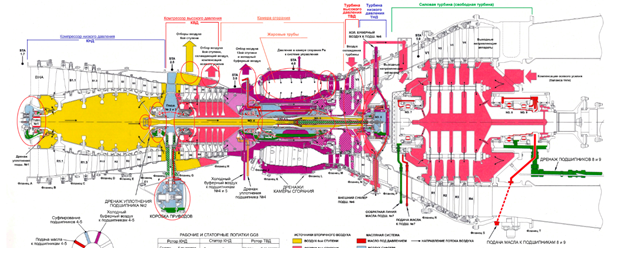
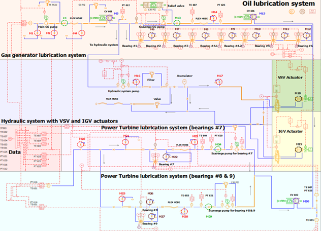
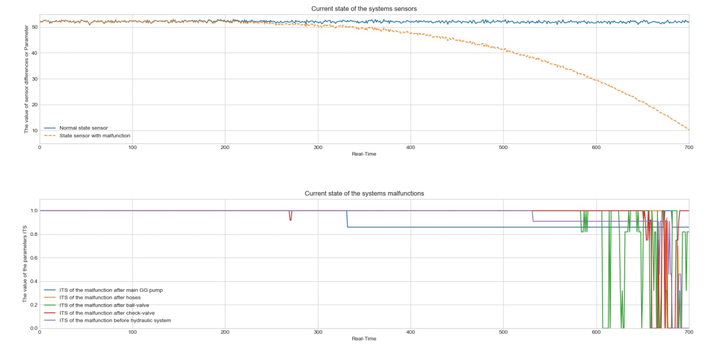

# Fault_diagnosis_using_hybrid_analytics
El propósito de este proyecto es generar la metodología para el análisis prescriptivo de equipos dinámicos utilizando modelado híbrido. La metodología permite predecir la ubicación específica de dicha falla y el valor numérico del parámetro de falla. Como ejemplo de sistema dinámico, se investiga la turbina de gas industrial. Este proyecto tiene como objetivo utilizar datos generados de los parámetros reales de falla para los subsistemas de aceite e hidráulico mediante modelado matemático, y luego construir un modelo de regresión para predecir el índice de estado técnico (ITS) de cada una de las fallas.
# Turbine

Esta es la imagen de una turbina de gas industrial.
## Oil lubrication turbine subsystem
Una turbina de gas es un sistema dinámico muy complejo. El subsistema de lubricación de aceite es crucial para suministrar lubricante a los cojinetes. En la vida real, este subsistema opera casi sin fallas. Y el problema es que no existen datos para predecir todas las fallas potenciales que pueden ocurrir en este tipo de subsistema. Utilizando modelado híbrido, es posible (enfoque basado en principios físicos más métodos de aprendizaje automático).

### Results on leakages real-time monitoring
Una metodología general se divide en los siguientes pasos:
1.	Recopilar datos de un socio industrial sobre el subsistema (`csv-file`).
2.	Diseñar un modelo matemático (por ejemplo, utilizando Amesim, Matlab, Python);
3.	Procesos de simulación y optimización en el modelo;
4.	Investigar las fallas reales que pueden ocurrir en el subsistema actual según la documentación de los socios industriales;
5.	Generar los datos de las diferentes fallas;
6.	Crear una tabla de correlaciones entre el parámetro de falla y las salidas específicas según los documentos del socio industrial;
7.	Analizar los datos utilizando métodos de aprendizaje automático;
8.	Construir matrices de influencia para todo el subsistema; 
9.	Utilizar un modelo de clasificación existente para clasificar diferentes fallas en el subsistema;
10.	Construir un modelo predictivo para todo el subsistema que permita predecir cada una de las fallas;
11.	Construir el modelo de clasificación y predicción en tiempo real utilizando predicción de series temporales. 

# Más información
Para utilizar esta metodología, debe enviarme un correo electrónico y le ayudaré con:
1) Cómo construir un modelo matemático;
2) Cómo generar datos a partir del modelo matemático utilizando `Python`;
3) Cómo construir modelos de ML basados en datos generados;
4) Cómo operar con modelos de ML en aplicaciones en tiempo real utilizando el impresionante `Streamlit` (agregaré más información al respecto un poco más adelante);

No dude en escribirme por correo electrónico: aleksandryessin@gmail.com.
